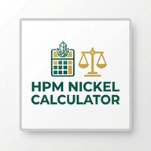
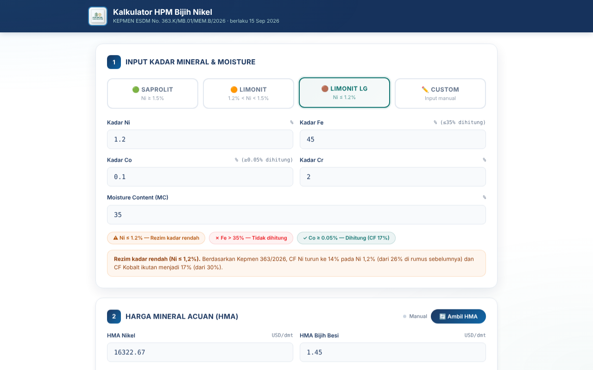
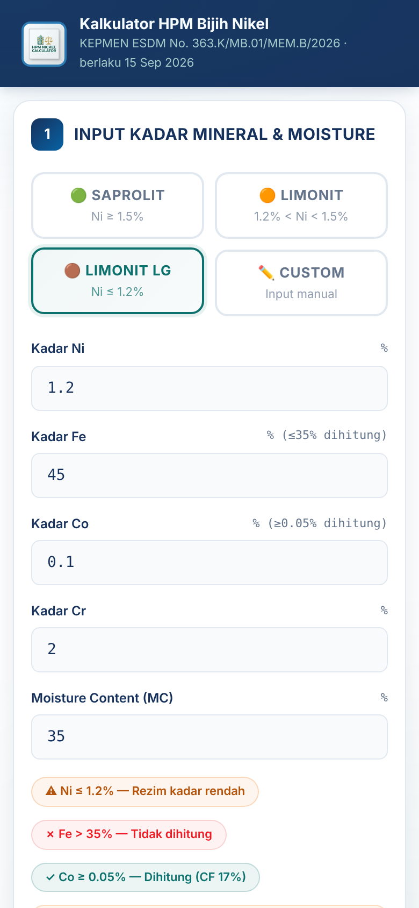
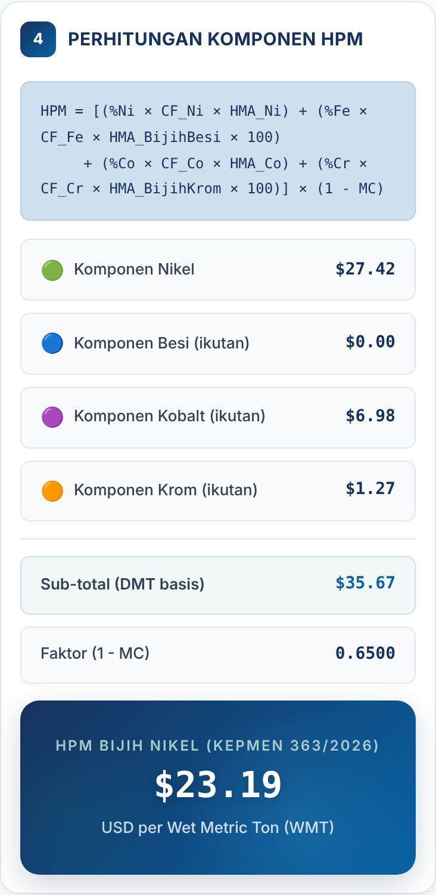
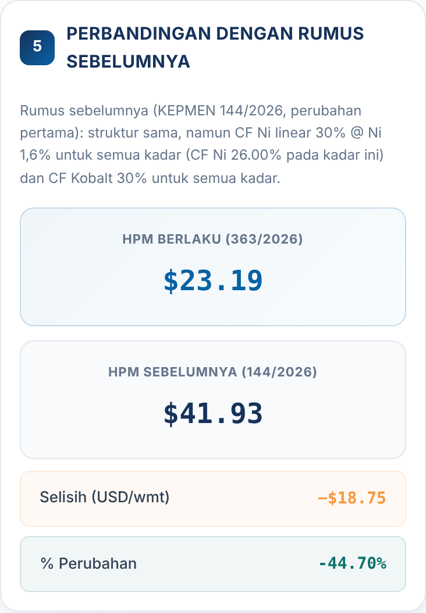

<div align="center">



# Kalkulator HPM Bijih Nikel

**Hitung Harga Patokan Mineral (HPM) bijih nikel sesuai Kepmen ESDM No. 363.K/MB.01/MEM.B/2026, langsung dari browser atau ponsel.**

[](https://raihankarim19.github.io/Kalkulator-HPM-Nikel/)

[](https://github.com/raihankarim19/Kalkulator-HPM-Nikel/actions/workflows/test.yml)


<br>



</div>

---

## Kenapa kalkulator ini

HPM menjadi batas bawah harga jual bijih nikel domestik dan dasar perhitungan royalti. Sejak Kepmen 144/2026, HPM tidak lagi hanya dihitung dari Ni, tetapi juga Fe, Co, dan Cr sebagai mineral ikutan. Kepmen 363/2026 lalu menurunkan CF untuk bijih kadar rendah. Menghitungnya manual di spreadsheet rawan salah, terutama di batas kadar.

Kalkulator ini:

- 🧮 **Menghitung HPM per komponen**: Ni, Fe, Co, Cr, lalu konversi ke basis basah (wmt).
- ⚖️ **Menerapkan dua rezim CF otomatis**: normal (Ni > 1,2%) dan kadar rendah (Ni ≤ 1,2%).
- 🚦 **Memeriksa ambang mineral ikutan**: Fe ≤ 35% dan Co ≥ 0,05%.
- 🔄 **Membandingkan dengan rumus sebelumnya** (Kepmen 144/2026), lengkap dengan selisih dan persentase perubahan.
- 🌐 **Mengambil HMA terbaru dalam sekejap** dari [`hma.json`](hma.json) yang diperbarui otomatis tiap hari, atau bisa diisi manual.
- 📲 **Bisa di-install sebagai aplikasi** (PWA) dan tetap jalan offline.

## Rumus

```
HPM (USD/wmt) = [ (%Ni × CF_Ni × HMA_Nikel)
                + (%Fe × CF_Fe × HMA_BijihBesi × 100)
                + (%Co × CF_Co × HMA_Kobalt)
                + (%Cr × CF_Cr × HMA_BijihKrom × 100) ] × (1 − MC)
```

| Parameter | Ni > 1,2% | Ni ≤ 1,2% |
|---|---|---|
| **CF Ni** | 30% + ((Ni − 1,6%) ÷ 0,1%) × 1% | **14%** + ((Ni − 1,2%) ÷ 0,1%) × 1% |
| **CF Co** (dihitung bila Co ≥ 0,05%) | 30% | **17%** |
| **CF Fe** (dihitung bila Fe ≤ 35%) | 30% | 30% |
| **CF Cr** | 10% | 10% |

> [!IMPORTANT]
> Ada lompatan CF di batas 1,2%: Ni 1,20% mendapat CF 14%, sedangkan Ni 1,21% mendapat 26,1%. Untuk bijih saprolit dan limonit di atas 1,2%, hasil Kepmen 363/2026 sama persis dengan Kepmen 144/2026.

Penjelasan lengkap, tabel CF per kadar, dan sumber ada di **[docs/RUMUS.md](docs/RUMUS.md)**.

### Contoh perhitungan

Limonit kadar rendah, HMA Periode I Oktober 2026:

| Input | Nilai |
|---|---|
| Ni / Fe / Co / Cr | 1,2% / 45% / 0,10% / 2% |
| MC | 35% |
| HMA Ni / Co / Bijih Besi / Bijih Krom | 16.322,67 / 41.047,33 / 1,45 / 6,37 USD |

| Komponen | Perhitungan | USD/dmt |
|---|---|---|
| Nikel | 0,012 × 14% × 16.322,67 | 27,42 |
| Besi | Fe > 35%, tidak dihitung | 0,00 |
| Kobalt | 0,001 × 17% × 41.047,33 | 6,98 |
| Krom | 0,02 × 10% × 6,37 × 100 | 1,27 |
| **Sub-total** | | **35,67** |
| **HPM** | 35,67 × (1 − 0,35) | **23,19 USD/wmt** |

Dengan rumus Kepmen 144/2026, bijih yang sama bernilai 41,93 USD/wmt, jadi HPM turun **44,7%**.

## Tampilan

<div align="center">
<table>
<tr>
<td align="center"><br><sub>Input kadar & rezim CF</sub></td>
<td align="center"><br><sub>Rincian komponen HPM</sub></td>
<td align="center"><br><sub>Perbandingan rumus</sub></td>
</tr>
</table>
</div>

## Data HMA

Browser tidak bisa membaca situs ESDM secara langsung (diblokir CORS), dan proxy publik sering mati. Karena itu HMA disimpan di [`hma.json`](hma.json), satu domain dengan aplikasi:

1. **GitHub Actions** ([`update-hma.yml`](.github/workflows/update-hma.yml)) menjalankan [`scripts/update-hma.mjs`](scripts/update-hma.mjs) setiap hari pukul 08.17 WIB. Script mengambil tabel HMA dari minerba.esdm.go.id di sisi server.
2. `hma.json` **hanya ditulis bila keempat HMA ditemukan dan lolos uji kewajaran**. Bila situs ESDM down, sedang perbaikan, atau strukturnya berubah, data lama dibiarkan.
3. Tombol **🔄 Ambil HMA** membaca `hma.json`. Proxy ke situs ESDM hanya dipakai sebagai cadangan terakhir.

**Memperbarui manual:** edit `hma.json` langsung di GitHub (ikon ✏️), ganti angka dan `periode`, lalu commit. Workflow juga bisa dijalankan kapan saja dari tab **Actions → Perbarui HMA → Run workflow**.

## Cara pakai

1. Buka **[raihankarim19.github.io/Kalkulator-HPM-Nikel](https://raihankarim19.github.io/Kalkulator-HPM-Nikel/)**.
2. Pilih preset (Saprolit, Limonit, Limonit LG) atau **Custom**, lalu isi kadar Ni, Fe, Co, Cr, dan MC dalam persen.
3. HMA terbaru terisi otomatis saat pertama dibuka. Tekan **🔄 Ambil HMA** untuk menyegarkan, atau isi manual.
4. HPM dan rinciannya langsung terhitung saat Anda mengetik.

**Install di ponsel:** buka di Chrome (Android) lalu pilih *Install*, atau di Safari (iOS) pilih *Share → Add to Home Screen*.

## Menjalankan secara lokal

Tidak ada build step dan tidak ada dependensi. Cukup sajikan foldernya lewat HTTP server apa pun:

```bash
git clone https://github.com/raihankarim19/Kalkulator-HPM-Nikel.git
cd Kalkulator-HPM-Nikel
python3 -m http.server 8000      # lalu buka http://localhost:8000
```

Menjalankan test (Node.js 18+):

```bash
npm test
```

Test memvalidasi engine terhadap angka HPM yang dipublikasikan Shanghai Metals Market untuk periode September II dan Oktober I 2026. Test ini juga berjalan otomatis lewat GitHub Actions setiap ada push.

## Struktur proyek

```
├── index.html          # UI + controller
├── calculator.js       # Engine perhitungan HPM (bisa dipakai di browser & Node)
├── styles.css          # Tampilan
├── sw.js               # Service worker (offline / PWA)
├── manifest.json       # Manifest PWA
├── hma.json            # HMA terbaru (diperbarui otomatis)
├── scripts/
│   └── update-hma.mjs  # Pengambil HMA dari ESDM (dipakai GitHub Actions)
├── tests/
│   ├── hpm.test.js         # Unit test engine
│   └── update-hma.test.mjs # Unit test parser HMA
├── docs/
│   ├── RUMUS.md        # Metodologi & sumber
│   └── img/            # Screenshot
└── CHANGELOG.md
```

## Riwayat regulasi

| Kepmen ESDM | Berlaku | Perubahan utama |
|---|---|---|
| 268.K/MB.01/MEM.B/2025 | 2025 | Pedoman induk HPM; HPM bijih nikel hanya dari Ni |
| 144.K/MB.01/MEM.B/2026 | 2026 | Fe, Co, Cr masuk sebagai mineral ikutan; CF Ni 30% @ Ni 1,6% |
| **363.K/MB.01/MEM.B/2026** | **15 Sep 2026** | CF Ni 14% dan CF Co 17% untuk Ni ≤ 1,2% |

Detail tiap versi kalkulator ada di [CHANGELOG.md](CHANGELOG.md).

## Disclaimer

Kalkulator ini adalah alat bantu independen dan **bukan produk resmi Kementerian ESDM**. Rumus disusun dari pemberitaan resmi dan direkonsiliasi dengan angka HPM yang dipublikasikan. Untuk transaksi, pelaporan, atau perhitungan royalti, selalu rujuk dokumen Kepmen dan HMA resmi dari [Ditjen Minerba ESDM](https://www.minerba.esdm.go.id/harga_acuan).

## Pembuat

Dibuat oleh **Raihan Karim**. Masukan dan laporan bug dipersilakan lewat [Issues](https://github.com/raihankarim19/Kalkulator-HPM-Nikel/issues).
